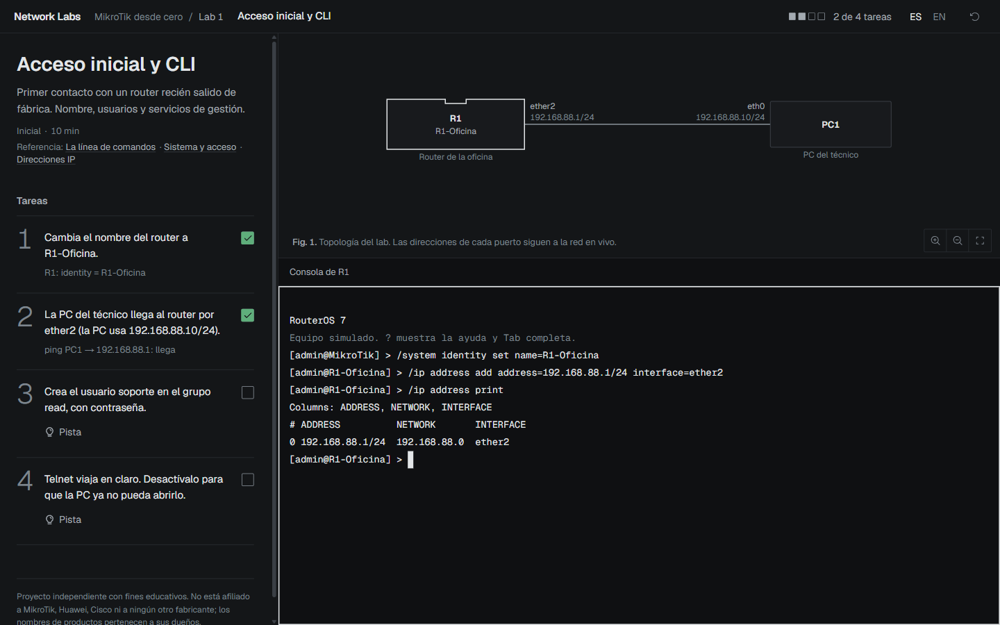
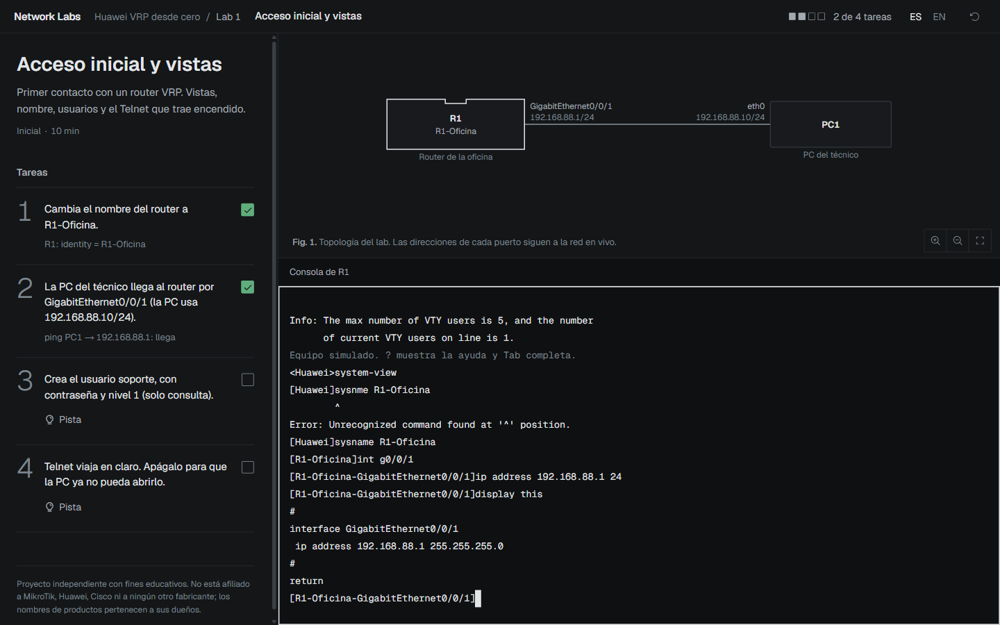
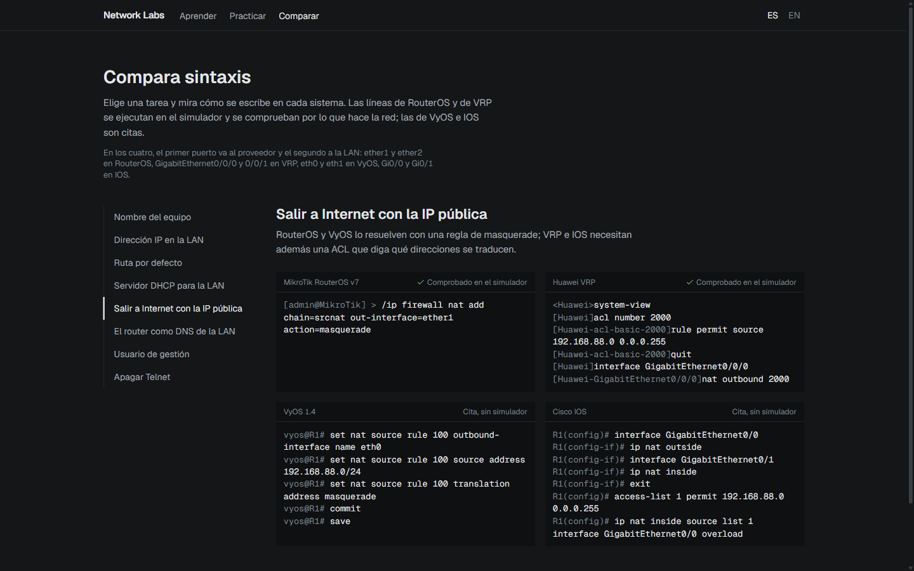
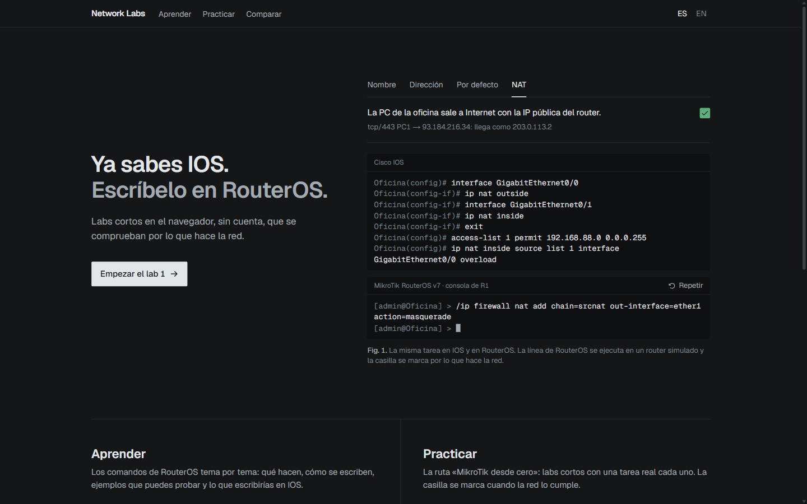
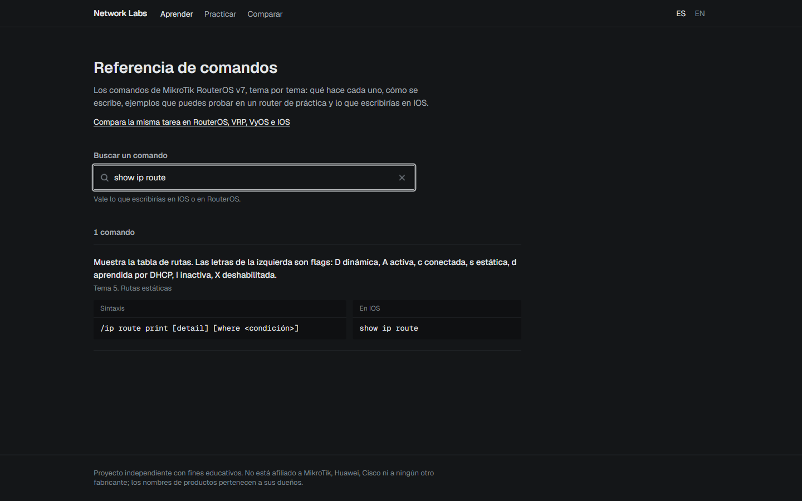
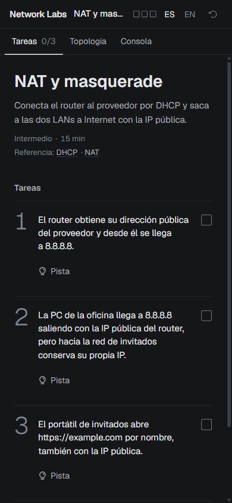

# Network Labs

Labs gratuitos en el navegador para aprender el CLI de **MikroTik RouterOS**, **Huawei VRP** y **Cisco IOS** practicando, sin instalar nada y sin equipos. Pensado sobre todo para quien ya conoce IOS y quiere moverse con soltura en otros sistemas operativos de red, y también para quien empieza por IOS.

*Free browser labs to learn the MikroTik RouterOS, Huawei VRP and Cisco IOS command line by practising. [English summary below](#english).*



## Qué es

Un proyecto abierto de aprendizaje. Cada lab te da un router simulado, una topología y unas tareas escritas en lenguaje normal ("la PC de la oficina sale a Internet con la IP pública del router"). Escribes los comandos en una consola que se comporta como la del equipo real y las tareas se marcan solas cuando la red hace lo que piden.

Lo importante: **se comprueba el estado de la red, no los comandos que escribiste**. Si llegas al objetivo por otro camino válido, también cuenta.

## Qué incluye

- **Elige el sistema.** Aprender, Practicar y la portada te dejan elegir RouterOS, VRP o IOS, y la portada recuerda el último que usaste.
- **Practicar.** Tres rutas de labs cortos:
  - *MikroTik desde cero*, 12 labs: acceso y CLI, interfaces y direcciones, rutas estáticas, bridge y VLANs, DHCP, NAT, firewall, wifi, DNS, respaldo, Torch y una oficina completa de principio a fin.
  - *Huawei VRP desde cero*, 4 labs: vistas y acceso, interfaces, rutas estáticas, y DHCP con NAT y DNS.
  - *Cisco IOS desde cero*, 4 labs: modos, usuario y SSH, interfaces que vienen apagadas, rutas estáticas, y la oficina con DHCP, NAT con ACL y DNS.
- **Aprender.** Una referencia de comandos por sistema, con sintaxis, ejemplos que puedes probar en un router de práctica y errores típicos; las de RouterOS y VRP traen además el equivalente en IOS. Tiene buscador: puedes escribir lo que pondrías en IOS (`show ip route`) y te lleva al comando de RouterOS o de VRP.
- **Comparar.** La misma tarea (poner una IP, una ruta por defecto, DHCP, NAT, DNS…) en RouterOS, VRP, IOS y VyOS, lado a lado. Las líneas de RouterOS, VRP e IOS se ejecutan en el simulador y se comprueban; las de VyOS son citas de referencia.
- **Consola realista.** Prompts, tablas, errores con la voz del equipo (incluido el `^` de VRP e IOS), ayuda con `?`, autocompletado con Tab y abreviaturas.
- **Topología en vivo.** La figura de cada lab muestra las direcciones reales de cada puerto mientras configuras.
- **Español e inglés.** Todo el contenido está en los dos idiomas.
- **Sin cuenta.** El progreso se guarda en tu navegador.

| Huawei VRP, con su error de sintaxis real | Compara sintaxis |
| --- | --- |
|  |  |

| Portada | Buscador de la referencia | En el teléfono |
| --- | --- | --- |
|  |  |  |

## Probarlo en tu equipo

Necesitas [Node.js](https://nodejs.org) 20.9 o posterior.

```bash
git clone https://github.com/otoningo/network-labs.git
cd network-labs
npm install
npm run dev
```

Abre <http://localhost:3000>. Todo corre en el navegador: no hay servidor ni base de datos.

## Cómo funciona

```
apps/web          la web (Next.js): labs, referencia, comparador
packages/core     el simulador: un modelo de red neutral (interfaces, rutas,
                  DHCP, NAT, firewall, DNS...) y el motor que lo hace funcionar
packages/vendors  un driver por sistema: traduce la CLI de RouterOS, VRP o IOS
                  a operaciones sobre ese modelo
content/labs      los labs, en YAML
content/reference la referencia de comandos, en YAML
```

El núcleo no sabe nada de la sintaxis de ningún fabricante. Cada driver entiende su CLI, la convierte en cambios sobre el modelo neutral y genera la salida con el formato del equipo. Las tareas de un lab son predicados sobre el estado de la red ("PC1 llega a 192.168.88.1", "PC1 sale como 203.0.113.2"), así que no dependen de cómo escribiste los comandos.

Las decisiones técnicas, con sus alternativas, están en [DECISIONES.md](DECISIONES.md).

## Contribuir

Es un proyecto para aprender en público y las contribuciones son bienvenidas:

- **Labs nuevos o mejores pistas.** Un lab es un archivo YAML en `content/labs/<sistema>/` con su topología, sus tareas y sus pistas. Cada lab tiene pruebas que lo resuelven como lo haría un estudiante.
- **Comandos que faltan.** Si el simulador no entiende algo que el equipo real sí, abre un issue con el comando y la salida que esperabas.
- **Errores de comportamiento.** Si una salida o un mensaje de error no se parece al del equipo, cuéntalo en un issue.

Antes de abrir un pull request:

```bash
npm run check   # tipos, lint y pruebas
```

## Límites

Es un simulador, no un sistema operativo de red. Cubre lo que piden los labs y la referencia, y crece con ellos. Los drivers de VRP e IOS son más recientes y más acotados que el de RouterOS (por ejemplo, IOS no tiene todavía ACL extendidas ni NAT estático). VyOS solo aparece como cita en el comparador.

## English

Network Labs is an open learning project: free browser labs to practise the MikroTik RouterOS, Huawei VRP and Cisco IOS CLIs, aimed mainly at people who already know IOS and also at those starting with it. Each lab gives you a simulated router, a live topology and plain-language tasks; tasks are ticked by checking the **state of the network**, not the commands you typed. It includes 12 RouterOS labs, 4 VRP labs and 4 IOS labs, a searchable command reference for each system, and a side-by-side syntax comparison of RouterOS, VRP, IOS and VyOS. You pick the system in every section. The interface is available in Spanish and English. Run it locally with `npm install` and `npm run dev`.

---

Este proyecto no está afiliado a MikroTik, Huawei, Cisco, VyOS ni a ningún otro fabricante. Los nombres de productos pertenecen a sus dueños. No incluye binarios ni documentación de ningún fabricante: el comportamiento está escrito desde cero a partir de la documentación pública.

Los iconos de la topología (`apps/web/public/topology`) son los [iconos de topología de red de Cisco](https://www.cisco.com/c/en/us/about/brand-center/network-topology-icons.html), que Cisco permite usar libremente sin alterarlos. Aquí solo se han convertido de EPS a SVG, sin cambiar formas ni colores.
