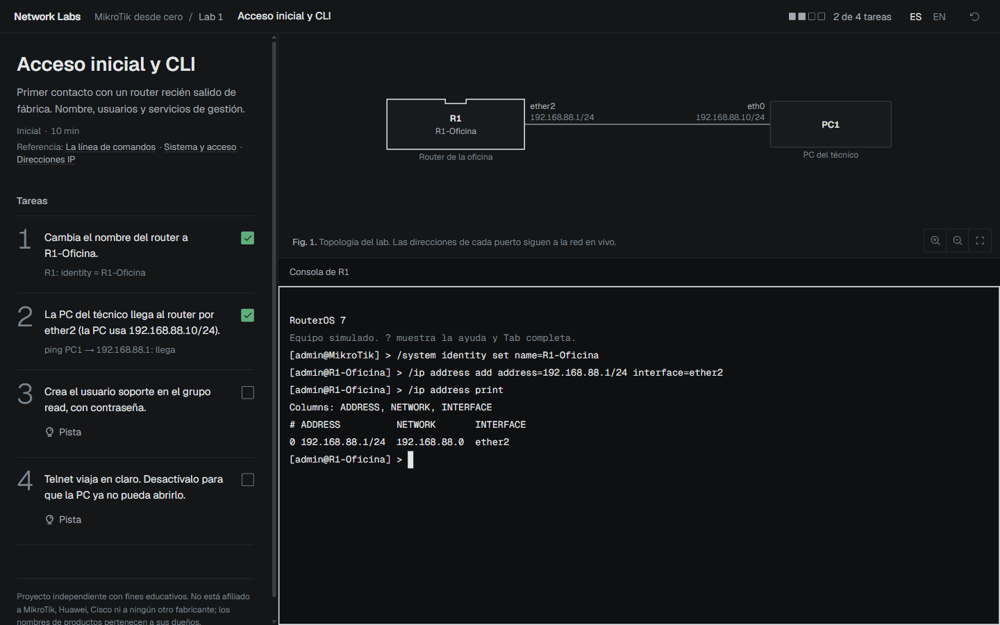
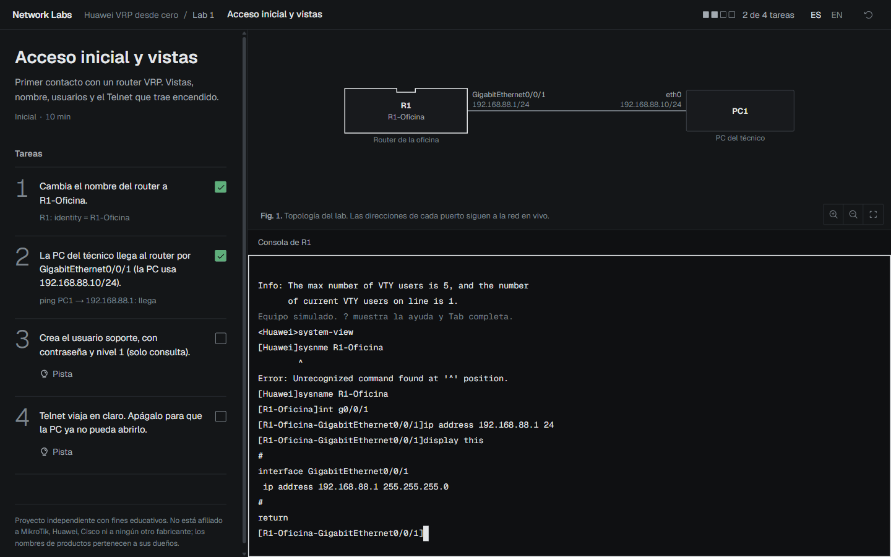
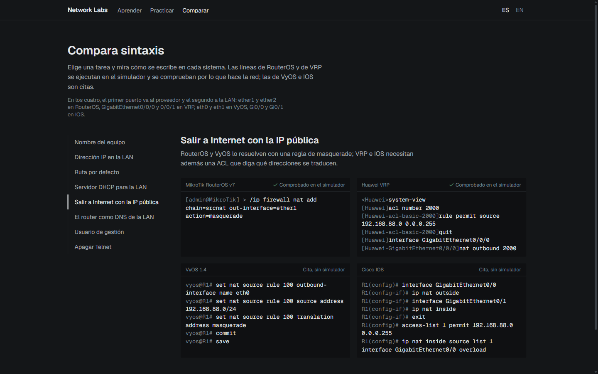
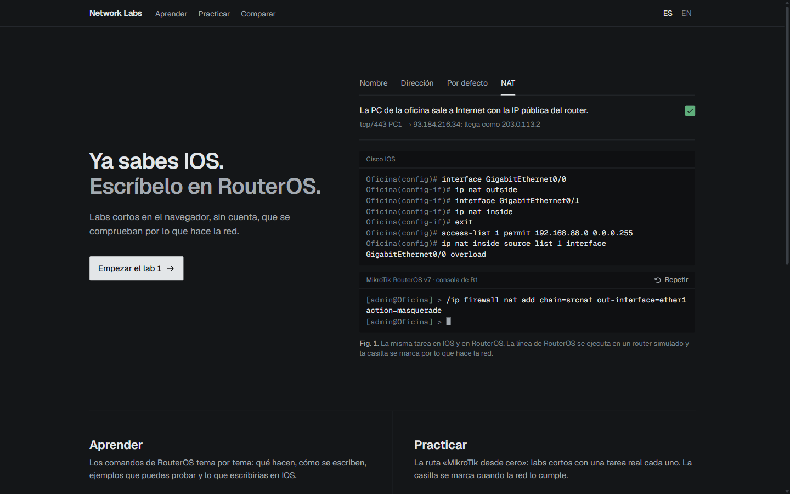
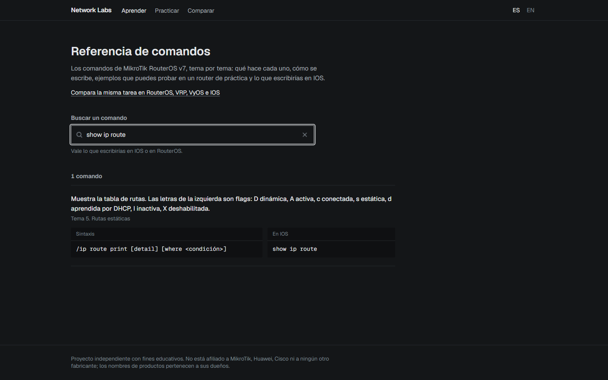
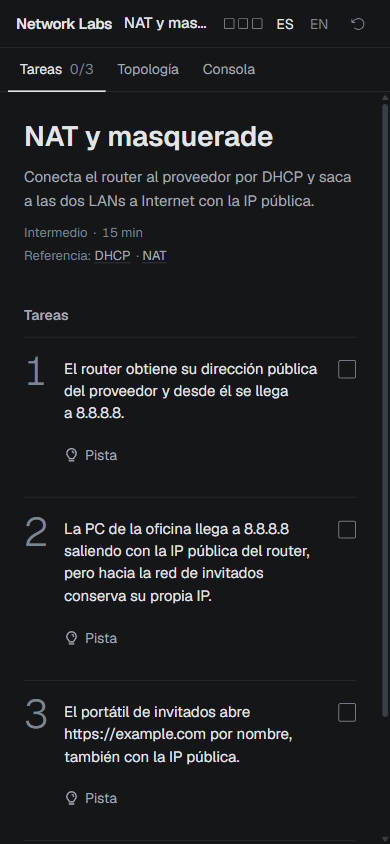

# Network Labs

Labs gratuitos en el navegador para aprender el CLI de **MikroTik RouterOS** y **Huawei VRP** practicando, sin instalar nada y sin equipos. Pensado para quien ya conoce Cisco IOS y quiere moverse con soltura en otros sistemas operativos de red.

*Free browser labs to learn the MikroTik RouterOS and Huawei VRP command line by practising. [English summary below](#english).*



## Qué es

Un proyecto abierto de aprendizaje. Cada lab te da un router simulado, una topología y unas tareas escritas en lenguaje normal ("la PC de la oficina sale a Internet con la IP pública del router"). Escribes los comandos en una consola que se comporta como la del equipo real y las tareas se marcan solas cuando la red hace lo que piden.

Lo importante: **se comprueba el estado de la red, no los comandos que escribiste**. Si llegas al objetivo por otro camino válido, también cuenta.

## Qué incluye

- **Practicar.** Dos rutas de labs cortos:
  - *MikroTik desde cero*, 12 labs: acceso y CLI, interfaces y direcciones, rutas estáticas, bridge y VLANs, DHCP, NAT, firewall, wifi, DNS, respaldo, Torch y una oficina completa de principio a fin.
  - *Huawei VRP desde cero*, 4 labs: vistas y acceso, interfaces, rutas estáticas, y DHCP con NAT y DNS.
- **Aprender.** Una referencia de comandos de RouterOS en 13 temas, con sintaxis, ejemplos que puedes probar en un router de práctica, errores típicos y el equivalente en IOS. Tiene buscador: puedes escribir lo que pondrías en IOS (`show ip route`) y te lleva al comando de RouterOS.
- **Comparar.** La misma tarea (poner una IP, una ruta por defecto, DHCP, NAT, DNS…) en RouterOS, VRP, VyOS e IOS, lado a lado. Las líneas de RouterOS y VRP se ejecutan en el simulador y se comprueban; las de VyOS e IOS son citas de referencia.
- **Consola realista.** Prompts, tablas, errores con la voz del equipo (incluido el `^` de VRP), ayuda con `?`, autocompletado con Tab y abreviaturas.
- **Topología en vivo.** La figura de cada lab muestra las direcciones reales de cada puerto mientras configuras.
- **Español e inglés.** Todo el contenido está en los dos idiomas.
- **Sin cuenta.** El progreso se guarda en tu navegador.

| Huawei VRP, con su error de sintaxis real | Compara sintaxis |
| --- | --- |
|  |  |

| Portada | Buscador de la referencia | En el teléfono |
| --- | --- | --- |
|  |  |  |

## Probarlo en tu equipo

Necesitas [Node.js](https://nodejs.org) 20.9 o posterior.

```bash
git clone https://github.com/otoningo/network-labs.git
cd network-labs
npm install
npm run dev
```

Abre <http://localhost:3000>. Todo corre en el navegador: no hay servidor ni base de datos.

## Cómo funciona

```
apps/web          la web (Next.js): labs, referencia, comparador
packages/core     el simulador: un modelo de red neutral (interfaces, rutas,
                  DHCP, NAT, firewall, DNS...) y el motor que lo hace funcionar
packages/vendors  un driver por sistema: traduce la CLI de RouterOS o de VRP
                  a operaciones sobre ese modelo
content/labs      los labs, en YAML
content/reference la referencia de comandos, en YAML
```

El núcleo no sabe nada de la sintaxis de ningún fabricante. Cada driver entiende su CLI, la convierte en cambios sobre el modelo neutral y genera la salida con el formato del equipo. Las tareas de un lab son predicados sobre el estado de la red ("PC1 llega a 192.168.88.1", "PC1 sale como 203.0.113.2"), así que no dependen de cómo escribiste los comandos.

Las decisiones técnicas, con sus alternativas, están en [DECISIONES.md](DECISIONES.md).

## Contribuir

Es un proyecto para aprender en público y las contribuciones son bienvenidas:

- **Labs nuevos o mejores pistas.** Un lab es un archivo YAML en `content/labs/<sistema>/` con su topología, sus tareas y sus pistas. Cada lab tiene pruebas que lo resuelven como lo haría un estudiante.
- **Comandos que faltan.** Si el simulador no entiende algo que el equipo real sí, abre un issue con el comando y la salida que esperabas.
- **Errores de comportamiento.** Si una salida o un mensaje de error no se parece al del equipo, cuéntalo en un issue.

Antes de abrir un pull request:

```bash
npm run check   # tipos, lint y pruebas
```

## Límites

Es un simulador, no un sistema operativo de red. Cubre lo que piden los labs y la referencia, y crece con ellos. El driver de VRP es más reciente y más acotado que el de RouterOS. VyOS e IOS solo aparecen como citas en el comparador.

## English

Network Labs is an open learning project: free browser labs to practise the MikroTik RouterOS and Huawei VRP CLIs, aimed at people who already know Cisco IOS. Each lab gives you a simulated router, a live topology and plain-language tasks; tasks are ticked by checking the **state of the network**, not the commands you typed. It includes 12 RouterOS labs, 4 VRP labs, a searchable RouterOS command reference with IOS equivalents, and a side-by-side syntax comparison of RouterOS, VRP, VyOS and IOS. The interface is available in Spanish and English. Run it locally with `npm install` and `npm run dev`.

---

Este proyecto no está afiliado a MikroTik, Huawei, Cisco, VyOS ni a ningún otro fabricante. Los nombres de productos pertenecen a sus dueños. No incluye imágenes, binarios ni documentación de ningún fabricante: el comportamiento está escrito desde cero a partir de la documentación pública.
